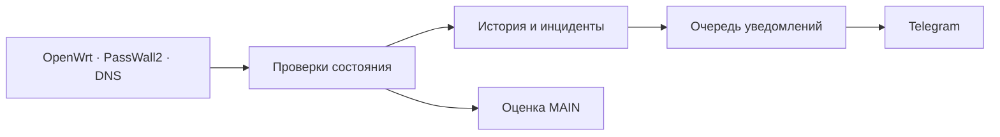

# CUDY Home Gateway

Диагностика домашней сети на OpenWrt, история инцидентов и уведомления в Telegram. Gateway показывает, где оборвалась связь: у провайдера, в DNS, на выходе VPN или в отдельном клиентском профиле.

**На CUDY TR3000 v1 установлена сборка `0.8.0-dev`.** После установки подтверждены работа Telegram, выход MAIN, доступность обоих VPN-резервов и выход с Windows-клиента в LAN. [Отчёт установки и проверок](docs/reports/RECOVERY_20261126_LIVE.md)

[Пакеты и история выпусков](https://github.com/bsekinaev/cudy-home-gateway/releases) · [План до 1.0](docs/superpowers/plans/2026-11-26-release-1.0.md)

## Что показывает Gateway

| Задача | Где смотреть |
|---|---|
| Отличить сбой WAN, DNS и VPN | `gateway health --json` или статус в Telegram |
| Посмотреть открытия и восстановления инцидентов | `gateway incidents --json`, в Telegram — `/summary` и `/history` |
| Проверить настроенный VPN-резерв через отдельный SOCKS | `gateway candidate-check NODE` по SSH |
| Проверить выход с компьютера в LAN | [Клиентская проверка Windows](scripts/lan-check.ps1) |

### Telegram

Экран показывает состояние процессов и отдельно — результат и возраст проверки сетевого доступа. DNS-проверка REDMI относится к его сетевому профилю. Для проверки интернета самого телефона нужен запрос с телефона.


Снимок сделан 21 ноября 2026 года. IP-адреса скрыты. [Руководство по Telegram](docs/TELEGRAM.md)

## Быстрая диагностика

На роутере с установленным Home Gateway:

```sh
gateway version
gateway health --json
gateway incidents --json
gateway doctor
```

Для установки используйте пакет, подходящий к текущей сборке, и выполните отдельный Verify после Apply. [Выбор пакета](docs/RELEASES.md) · [Установка и откат](docs/DEPLOYMENT.md)

## Как устроен проект



На OpenWrt проект использует BusyBox, ucode и procd. Telegram принимает команды только от разрешённого пользователя и чата. Перезапуски разрешённых служб требуют отдельного подтверждения. Маршрутизация пользовательского трафика выполняется средствами OpenWrt и PassWall2.

[Архитектура](docs/ARCHITECTURE.md) · [Модель инцидентов](docs/INCIDENTS.md) · [Доставка уведомлений](docs/NOTIFICATIONS.md) · [Безопасные действия](docs/SAFE_ACTIONS.md)

## Путь к 1.0

В ветке разработки есть журнал решений MAIN в режиме наблюдения. Он использует свежие измерения WAN и MAIN. До включения автоматической смены узлов предстоит подтвердить переключение с проверкой из LAN, откат и восстановление после перезагрузки. Приёмка проводится для конкретной сборки.

[План выпуска](docs/superpowers/plans/2026-11-26-release-1.0.md) · [Матрица приёмки](docs/ACCEPTANCE.md) · [Переключение MAIN](docs/MAIN_TRANSACTIONS.md) · [Резервные копии](docs/BACKUP.md)

## Лицензия

Код распространяется по [MIT](LICENSE). Для включённых скриншотов Gatus действуют условия Apache-2.0. [Атрибуция и лицензия](docs/assets/observability/2026-11-20/CREDITS.md)
