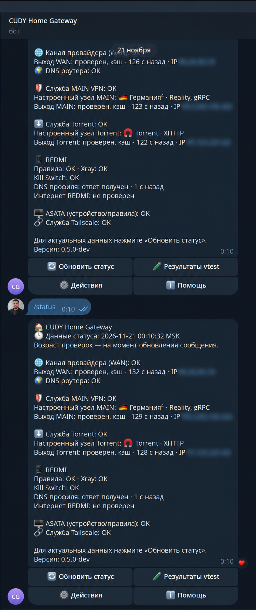
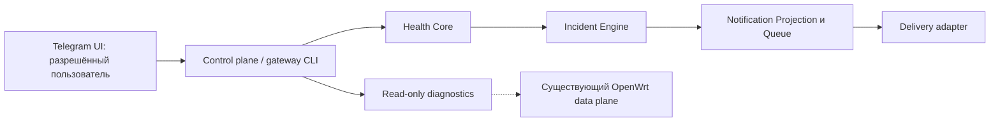
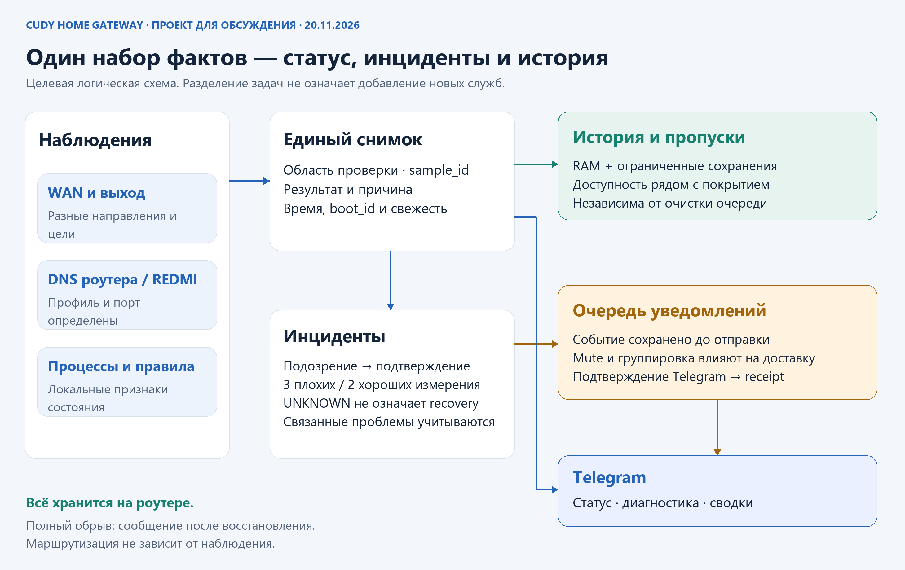

# CUDY Home Gateway

Лёгкий control plane для домашнего шлюза на OpenWrt: наблюдение за состоянием сети, безопасная диагностика, уведомления в Telegram и ограниченный набор подтверждаемых действий.

> Проект не заменяет маршрутизацию и не является частью data plane. Сбой Telegram-бота или control plane не должен нарушать работу интернета, PassWall2/Xray, DNS, Tailscale и пользовательских политик.

## Цели

- единый CLI `gateway` для статуса и безопасных действий;
- машинный JSON API поверх CLI;
- health engine со состояниями `OK / DEGRADED / DOWN / UNKNOWN / MAINTENANCE`;
- Telegram UI на русском с inline-кнопками и живым dashboard;
- интеграция с существующим `vtest` без автоматической смены MAIN;
- транзакционные изменения конфигурации с snapshot, post-check и rollback;
- журнал действий, защита от replay и блокировки параллельных операций;
- локальные резервные копии с ротацией.

## Принципы безопасности

- только один разрешённый Telegram user/chat;
- никакого `/exec`, shell-консоли, произвольного UCI или nftables из Telegram;
- секреты не хранятся в Git и не выводятся в логи;
- опасные действия требуют подтверждения и имеют TTL;
- Telegram не используется как единственный аварийный канал администрирования;
- текущая стабильная конфигурация роутера остаётся независимой от проекта.

## Технологический подход

Системный слой проектируется для OpenWrt/BusyBox и использует штатные инструменты (`ash`, `uci`, `ubus`, `nft`, `curl`, `jsonfilter`, `procd`). Read-only preflight подтвердил наличие `ucode`, поэтому Telegram orchestration и state machine проектируются на `ucode`, а небольшие системные adapters остаются на BusyBox shell.

## Статус

25.11.2026 опубликован и установлен [выпуск подготовки WAN](https://github.com/bsekinaev/cudy-home-gateway/releases/tag/v0.5.0-dev.20261125), source `a277d07`, от `1fc822c`. CI 17/17 и испытания V4 67/67 прошли. Preflight/Apply/Verify PASS на CUDY, selftest 62/0, doctor 11/0/0. Свежая история мониторинга подтверждена через read-only SSH. [Отчёт установки](docs/reports/WAN_20261125_LIVE.md).

**Разработка продолжается.** `0.5.0-dev` — не стабильный production-релиз.

На CUDY TR3000 v1 / OpenWrt 25.12.5 владелец установил обновление
`1fc822c3bddc1021a1d641c7d7cce71fab7332b8`: Preflight, Apply и отдельный Verify —
PASS; selftest 62/0, doctor 11/0/0. Проверка завершена 21.11.2026 по Москве.
Runtime — `0.5.0-dev`. [Отчёт установки мониторинга](docs/reports/MONITORING_20261121_LIVE.md).
Предыдущие пакеты, receipts и sessions сохраняются для истории и восстановления.

В Telegram установлена отдельная DNS-проверка профиля REDMI с возрастом результата.
Порт связывается с процессом, конфигурацией и UDP-сокетом; смена контекста
аннулирует результат. DNS-ответ не подтверждает интернет самого телефона.

### Telegram на работающем CUDY

Реальный скриншот владельца после обновления DNS (`62b5c4a`), 21.11.2026. Все IP-адреса скрыты
перед публикацией; остальные результаты относятся к моменту снимка.



Официальные пакеты и история публикуются в [GitHub Releases](https://github.com/bsekinaev/cudy-home-gateway/releases).
[Как выбрать пакет, версии и их исходные baseline](docs/RELEASES.md).
Дата в теге различает сборки; внутренняя версия gateway остаётся 0.5.0-dev.
При установке нужны собственный Preflight и отдельный Verify; сборка исходников
из GitHub не заменяет проверенный owner-пакет.

Дальше — проверка Telegram и клиентов, приёмка уведомлений и 24–72 часа наблюдения;
затем подготовка WAN к переезду. [Порядок работ](docs/OBSERVABILITY_PLAN.md),
[иллюстрированное руководство](docs/OBSERVABILITY.md),
[исследование похожих проектов](docs/research/2026-11-20-monitoring-projects.md).
Web UI и автоматическая смена локаций не добавляются.

Опубликован [выпуск мониторинга v0.5.0-dev.20261121](https://github.com/bsekinaev/cudy-home-gateway/releases/tag/v0.5.0-dev.20261121)
от установленного baseline `62b5c4a`: независимые минутные проверки
WAN/DNS/MAIN/REDMI, сообщения о сбоях и восстановлении, история 7/30 суток,
`/summary` и `/history`. [Проверки — 16/16](https://github.com/bsekinaev/cudy-home-gateway/actions/runs/44835123653);
native monitor 66/66, V2 regression 67/67, V1 regression 81/81.

В ZIP есть `START.cmd`: Preflight → Apply → отдельный Verify → включение
уведомлений. No-install проверка владельца на CUDY: цикл 4,34 с, четыре
направления OK. Владелец установил новый runtime и включил четыре категории
уведомлений. 22.11 владелец подтвердил ответы бота и интернет на компьютере
и REDMI. Проверка фактической доставки инцидентов и длительное наблюдение продолжаются.
[Реализация, замеры и границы](docs/reports/MONITORING_FOUNDATION_20261121.md).


Reboot persistence, независимый end-to-end traffic, длительный soak и реальный
sysupgrade restore этим acceptance не доказаны. Окончательного v1.0.0 acceptance нет.

`0.5 — Health & Alerts / in progress`

Health Core нормализует WAN, DNS, MAIN и service/policy observations. Incident State добавляет debounce/hysteresis и persistent journal. Adaptive external confirmation вызывает secondary egress provider только после неуспешного primary probe. Data plane не изменяется.

Notification Dispatcher объединён в main через PR #6 после успешного CI: retry,
MAIN/Torrent delivery, recovery summary, CLI mute/categories и sysupgrade allowlist.
Доставка выключена по умолчанию; владелец включил четыре категории preset мониторинга.
Добавлена crash-safe compaction с dedup receipts. LIVE-проверка доставки на CUDY ожидается;
CI каждой новой ветки проверяется отдельно. `0.5.0-dev` пока не является стабильным релизом.

[Установка и ограничения диспетчера](docs/NOTIFICATIONS.md).

## Архитектура в одном экране



**Граница безопасности:** control plane наблюдает за состоянием OpenWrt и предоставляет ограниченные управляющие операции, но **не является компонентом маршрутизации**. Никаких произвольных shell-команд через Telegram; опасные операции требуют отдельных проверок и разрешения владельца. Диаграмма описывает логическую архитектуру, а не гарантию, что каждый компонент установлен на реальном устройстве.

Подробности: [архитектура](docs/ARCHITECTURE.md), [инциденты](docs/INCIDENTS.md), [уведомления](docs/NOTIFICATIONS.md).

Целевая схема следующего этапа, а не снимок установленной реализации:



## Демонстрация безопасных сценариев

Ниже — команды **только для уже установленного экземпляра** Gateway CLI. Они не меняют MAIN, конфигурацию роутера или сетевые правила. Не исполняйте команды установки, миграции либо rollback ради демонстрации.

```sh
gateway help           # доступные команды и ограничения
gateway version        # установленная версия
gateway status --json  # сводка состояния
gateway health --json  # нормализованное состояние компонентов
gateway incidents --json # подтверждённые инциденты и кандидаты
gateway doctor         # проверка окружения и зависимостей
gateway selftest       # локальная проверка установленного CLI
```

Для технического интервью здесь показаны три решения:
- **Разделение control plane / data plane:** проблемы Telegram, health и очереди уведомлений не должны менять пользовательскую маршрутизацию.
- **Инциденты без шумовых уведомлений:** Health Core → debounce/hysteresis → Incident Engine → Projection → Queue.
- **Безопасные изменения:** preflight, snapshot, проверяемое решение, post-check, journal и rollback. Наличие механизма в исходниках **не** означает приёмку новых миграций на устройстве.

## Подтверждённые проверки и границы готовности

| Проверка | Результат | Что она подтверждает |
|---|---|---|
| [GitHub Actions CI, 21.10.2026](https://github.com/bsekinaev/cudy-home-gateway/actions/runs/39576418134) | PASS | Проверки исходников в CI; не установку на роутер |
| [Owner LIVE, RC-B 19–20.10.2026](docs/reports/HGDEPLOY2_RC_B_20261019_2_OWNER_LIVE.md) | **Apply заблокирован; rollback PASS** | Восстановление рабочего состояния после неуспешного кандидата |
| Selftest и doctor после rollback | **58 PASS / 0 FAIL; 11 OK / 0 WARN / 0 FAIL** | Состояние восстановленного legacy-окружения, не приёмку нового RC-B |
| Owner LIVE RC-B 20261020.2, 21.10.2026 | **COMMITTED; Verify PASS; selftest 62/0; doctor 11/0/0** | Принятая исходная миграция HGDEPLOY2; см. [матрицу приёмки](docs/ACCEPTANCE.md#owner-live-hgdeploy2-rc-b-202610202--21-october-2026-msk) |
| [Owner series fb8d9e3, 20.11.2026](docs/reports/HGDEPLOY2_OWNER_SERIES_20261120_LIVE.md) | **Apply/Verify PASS; selftest 62/0; doctor 11/0/0; владелец подтвердил работу** | Текущий observer UI и последовательное обновление на CUDY; не полную LIVE-приёмку доставки/rollback/soak |

Отчёт RC-B 19–20 октября подтверждает возврат к прежнему состоянию после отказа.
Последующая установка RC-B 20261020.2 подтверждена отдельно в ACCEPTANCE.
У проекта нет подтверждённого production-релиза 1.0.0; автоматический write-deploy
не должен предполагаться активным.

[Подробный отчёт о LIVE и rollback](docs/reports/HGDEPLOY2_RC_B_20261019_2_OWNER_LIVE.md) · [матрица приёмки](docs/ACCEPTANCE.md) · [развёртывание и ограничения](docs/DEPLOYMENT.md)

## Документация

- [Архитектура](docs/ARCHITECTURE.md)
- [Инженерные решения](docs/DECISIONS.md)
- [План релизов](docs/ROADMAP.md)
- [Наблюдение за интернетом: план и иллюстрации](docs/OBSERVABILITY.md)
- [Исследование похожих проектов и источники](docs/research/2026-11-20-monitoring-projects.md)
- [Матрица приёмки v1.0.0 и блокеры](docs/ACCEPTANCE.md)
- [MAIN Transactions: read-only planner и ограничения](docs/MAIN_TRANSACTIONS.md)
- [Health Core](docs/HEALTH.md)
- [Incident State](docs/INCIDENTS.md)
- [Аудит vtest и блокеры 0.6](docs/VTEST.md)
- [Safe Actions и migration 0.7](docs/SAFE_ACTIONS.md)
- [Приватные backup: проверка и ограничения 0.9](docs/BACKUP.md)
- [Adaptive External Probes](docs/ADAPTIVE_PROBES.md)
- [CI/CD](docs/CI_CD.md)
- [Telegram read-only](docs/TELEGRAM.md)
- [Результаты preflight](docs/PREFLIGHT.md)

## Лицензия

Основной код — MIT. Включённые официальные скриншоты Gatus сохраняют Apache-2.0:
[источники, атрибуция и лицензия](docs/assets/observability/2026-11-20/CREDITS.md).
