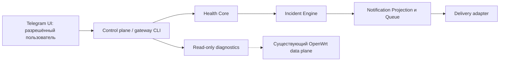

# CUDY Home Gateway

Лёгкий control plane для домашнего шлюза на OpenWrt: наблюдение за состоянием сети, безопасная диагностика, уведомления в Telegram и ограниченный набор подтверждаемых действий.

> Проект не заменяет маршрутизацию и не является частью data plane. Сбой Telegram-бота или control plane не должен нарушать работу интернета, PassWall2/Xray, DNS, Tailscale и пользовательских политик.

## Цели

- единый CLI `gateway` для статуса и безопасных действий;
- машинный JSON API поверх CLI;
- health engine со состояниями `OK / DEGRADED / DOWN / UNKNOWN / MAINTENANCE`;
- Telegram UI на русском с inline-кнопками и живым dashboard;
- интеграция с существующим `vtest` без автоматической смены MAIN;
- транзакционные изменения конфигурации с snapshot, post-check и rollback;
- журнал действий, защита от replay и блокировки параллельных операций;
- локальные резервные копии с ротацией.

## Принципы безопасности

- только один разрешённый Telegram user/chat;
- никакого `/exec`, shell-консоли, произвольного UCI или nftables из Telegram;
- секреты не хранятся в Git и не выводятся в логи;
- опасные действия требуют подтверждения и имеют TTL;
- Telegram не используется как единственный аварийный канал администрирования;
- текущая стабильная конфигурация роутера остаётся независимой от проекта.

## Технологический подход

Системный слой проектируется для OpenWrt/BusyBox и использует штатные инструменты (`ash`, `uci`, `ubus`, `nft`, `curl`, `jsonfilter`, `procd`). Read-only preflight подтвердил наличие `ucode`, поэтому Telegram orchestration и state machine проектируются на `ucode`, а небольшие системные adapters остаются на BusyBox shell.

## Статус

**Разработка продолжается.** `0.5.0-dev` — не стабильный production-релиз. Статус отдельных компонентов и внедрения подтверждается только конкретными отчётами и проверками.

Health Core нормализует WAN, DNS, MAIN и service/policy observations. Incident State добавляет debounce/hysteresis и persistent journal. Adaptive external confirmation вызывает secondary egress provider только после неуспешного primary probe. Data plane не изменяется.

Notification Dispatcher объединён в main через PR #6 после успешного CI: retry,
MAIN/Torrent delivery, recovery summary, CLI mute/categories и sysupgrade allowlist.
Доставка выключена по умолчанию. Добавлена crash-safe compaction с dedup receipts. Приёмка на CUDY ожидается;
CI каждой новой ветки проверяется отдельно. `0.5.0-dev` пока не является стабильным релизом.

[Установка и ограничения диспетчера](docs/NOTIFICATIONS.md).

## Архитектура в одном экране



**Граница безопасности:** control plane наблюдает за состоянием OpenWrt и предоставляет ограниченные управляющие операции, но **не является компонентом маршрутизации**. Никаких произвольных shell-команд через Telegram; опасные операции требуют отдельных проверок и разрешения владельца. Диаграмма описывает логическую архитектуру, а не гарантию, что каждый компонент установлен на реальном устройстве.

Подробности: [архитектура](docs/ARCHITECTURE.md), [инциденты](docs/INCIDENTS.md), [уведомления](docs/NOTIFICATIONS.md).

## Демонстрация безопасных сценариев

Ниже — команды **только для уже установленного экземпляра** Gateway CLI. Они не меняют MAIN, конфигурацию роутера или сетевые правила. Не исполняйте команды установки, миграции либо rollback ради демонстрации.

```sh
gateway help           # доступные команды и ограничения
gateway version        # установленная версия
gateway status --json  # сводка состояния
gateway health --json  # нормализованное состояние компонентов
gateway incidents --json # подтверждённые инциденты и кандидаты
gateway doctor         # проверка окружения и зависимостей
gateway selftest       # локальная проверка установленного CLI
```

Для технического интервью здесь показаны три решения:
- **Разделение control plane / data plane:** проблемы Telegram, health и очереди уведомлений не должны менять пользовательскую маршрутизацию.
- **Инциденты без шумовых уведомлений:** Health Core → debounce/hysteresis → Incident Engine → Projection → Queue.
- **Безопасные изменения:** preflight, snapshot, проверяемое решение, post-check, journal и rollback. Наличие механизма в исходниках **не** означает приёмку новых миграций на устройстве.

## Подтверждённые проверки и границы готовности

| Проверка | Результат | Что она подтверждает |
|---|---|---|
| [GitHub Actions CI, 21.10.2026](https://github.com/bsekinaev/cudy-home-gateway/actions/runs/39576418134) | PASS | Проверки исходников в CI; не установку на роутер |
| [Owner LIVE, RC-B 19–20.10.2026](docs/reports/HGDEPLOY2_RC_B_20261019_2_OWNER_LIVE.md) | **Apply заблокирован; rollback PASS** | Восстановление рабочего состояния после неуспешного кандидата |
| Selftest и doctor после rollback | **58 PASS / 0 FAIL; 11 OK / 0 WARN / 0 FAIL** | Состояние восстановленного legacy-окружения, не приёмку нового RC-B |
| Повторная установка RC-B | **BLOCKED** | Требуется отдельная проверенная процедура retirement и новая приёмка |

Отчёт владельца подтверждает возврат к прежнему состоянию, а **не успешный выпуск или установку кандидата**. Исходники и тестовые стенды не следует путать с LIVE-приёмкой на CUDY. У проекта нет подтверждённого production-релиза 1.0.0; автоматический write-deploy не должен предполагаться активным.

[Подробный отчёт о LIVE и rollback](docs/reports/HGDEPLOY2_RC_B_20261019_2_OWNER_LIVE.md) · [матрица приёмки](docs/ACCEPTANCE.md) · [развёртывание и ограничения](docs/DEPLOYMENT.md)

## Документация

- [Архитектура](docs/ARCHITECTURE.md)
- [Инженерные решения](docs/DECISIONS.md)
- [План релизов](docs/ROADMAP.md)
- [Матрица приёмки v1.0.0 и блокеры](docs/ACCEPTANCE.md)
- [MAIN Transactions: read-only planner и ограничения](docs/MAIN_TRANSACTIONS.md)
- [Health Core](docs/HEALTH.md)
- [Incident State](docs/INCIDENTS.md)
- [Аудит vtest и блокеры 0.6](docs/VTEST.md)
- [Safe Actions и migration 0.7](docs/SAFE_ACTIONS.md)
- [Приватные backup: проверка и ограничения 0.9](docs/BACKUP.md)
- [Adaptive External Probes](docs/ADAPTIVE_PROBES.md)
- [CI/CD](docs/CI_CD.md)
- [Telegram read-only](docs/TELEGRAM.md)
- [Результаты preflight](docs/PREFLIGHT.md)

## Лицензия

MIT.
