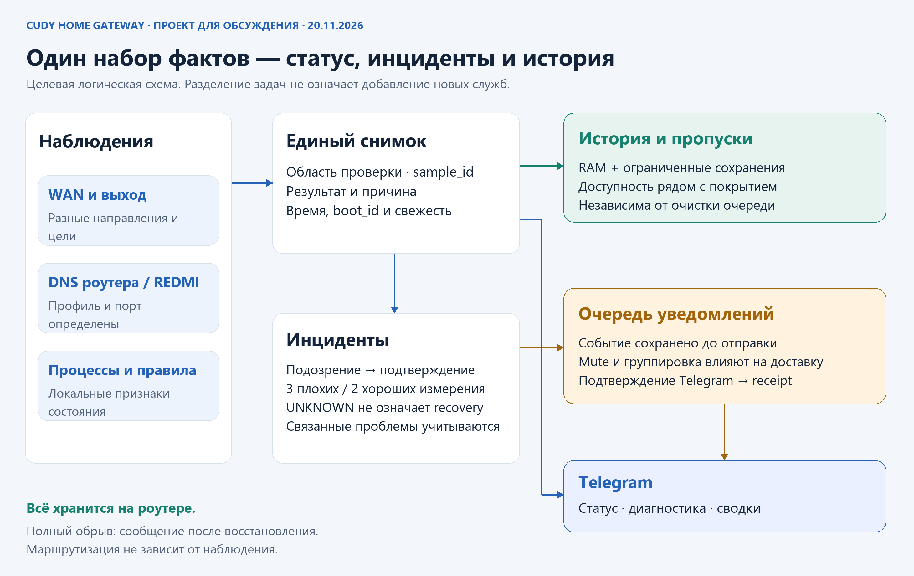
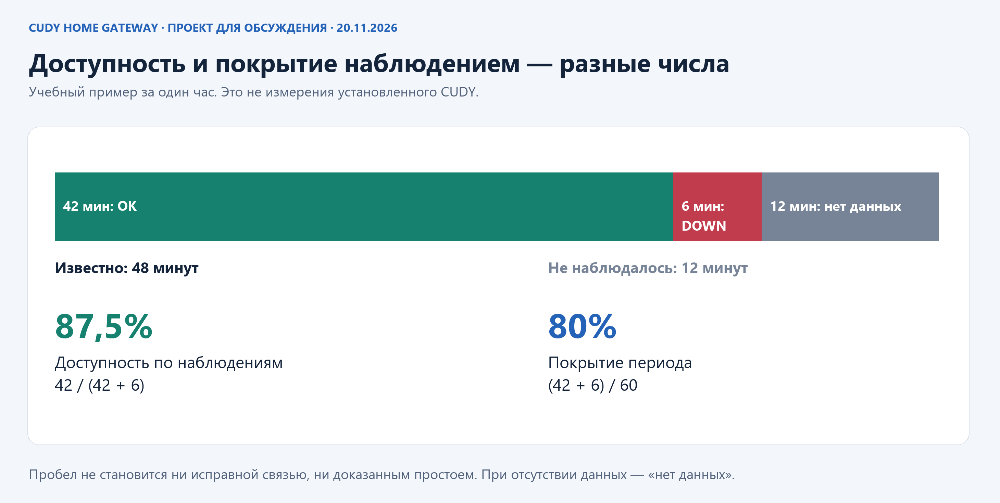
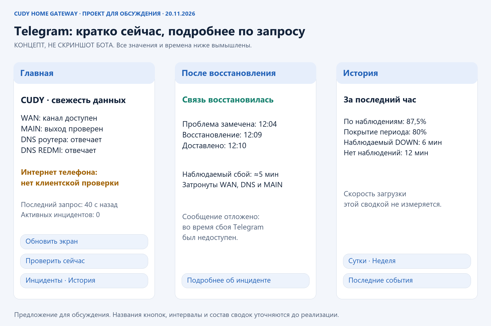

# План удобного наблюдения за интернетом

Актуально на **20 ноября 2026**. Установленный source
`fb8d9e3b021db592e369290df9753e65cead484d` принят владельцем:
Apply/Verify PASS, selftest 62/0, doctor 11/0/0.
[Подтверждение](reports/HGDEPLOY2_OWNER_SERIES_20261120_LIVE.md).
Дальнейшие функции ниже — проект, а не уже установленное обновление.

Всё остаётся на роутере. Интерфейс — Telegram. Если связь пропала полностью,
сообщение приходит после её восстановления. При выключенном роутере будет
отмечен пропуск наблюдения; точную длительность сетевой аварии он не знает.

## Что добавляем

| Этап | Результат для владельца | Как принимаем |
|---|---|---|
| Наблюдение 24–72 часа | Понятно, стабилен ли бот, хватает ли ресурсов, нет ли потерь наблюдения | Отчёт по перезапускам, времени проверок, очереди и покрытию; без искусственных обрывов на CUDY |
| DNS REDMI | Отдельный результат для действующего DNS-профиля и время проверки | Смена/пропажа профиля или порта, timeout и старый кэш не дают ложное «работает» |
| Уведомления | Сбой, восстановление и понятная сводка вместо каскада повторов | Свежие независимые проверки, mute/off/on, отказ Telegram, очередь и рестарт |
| Telegram-пульт | Краткая главная, подробности и ограниченная диагностика по запросу | Старые кнопки, повторные нажатия и недоступные компоненты; сохранён whitelist |
| История | Сутки/неделя, инциденты, длительности и честное покрытие периода | Пропуски, reboot, очистка очереди, неполный день и заполнение хранилища |

## Что изменилось после поиска похожих проектов

- Сначала общий результат измерения и его свежесть; потом экраны и проценты.
- Наблюдение отделяется от включения сообщений. Mute уже существует; независимый
  сбор при полностью выключенной доставке ещё нужно добавить.
- Один кэшированный результат не подтверждает сбой трижды. Интервал запроса и
  реальная задержка считаются вместе с временем выполнения.
- Связанные тревоги объединяются для отправки, но исходные факты сохраняются.
- История получает собственное ограниченное хранение. Её накопление начинается
  раньше появления красивой недельной сводки.
- Отдельно проверяем расширенный путь обновления: существующий installer
  рассчитан на узкий observer/UI scope, а не на любые новые модули.

Официальные источники, ограничения переносимости и настоящие скриншоты:
[сравнение Gatus, Alertmanager, OpenWrt и других проектов](research/2026-11-20-monitoring-projects.md).

## Предложения, которые предстоит проверить

Начальная частота: локальные признаки 30 с, активные проверки 60 с;
3 новых неуспеха / 2 успеха для инцидента. Ориентир 2–4 минуты до сообщения
согласован владельцем как цель при доступном Telegram; замером он ещё не подтверждён.
После полного обрыва время доставки не ограничено этим ориентиром.

Согласованы подробности 7 суток, дневные агрегаты 30 суток и допустимая потеря
до 15 минут несохранённых подробностей. Проектируем checkpoint
агрегатов раз в 15 минут. Это компромисс между сохранностью и записью во flash;
несохранённый хвост при потере питания может пропасть. Жёсткие размеры и
интервалы уточняются измерениями до выпуска.

Основной вариант — развить существующие процессы. Его пригодность подтвердит
стенд: медленный Telegram не должен останавливать сбор. При неудовлетворительном
результате отдельная служба потребует нового решения о поставке и запуске.

## Как может выглядеть Telegram

Изображение ниже — **концепт с вымышленными данными**, не скриншот установленного
бота. Успех DNS REDMI остаётся проверкой resolver, а не доказательством интернета
на телефоне. Скорость загрузки такая история не измеряет.

Подробная схема, границы, зависимости поставки и критерии каждого этапа:
[переработанный проект](superpowers/specs/2026-11-20-internet-observability-revised-design.md).
Все основные предпочтения получены. Автосообщения WAN/DNS/MAIN VPN/REDMI —
круглосуточно, сбой и восстановление, без напоминаний. Сводки по запросу.
Профиль REDMI проверяется без телефона; локация меняется вручную в PassWall2.
Добавлена подготовка к новому провайдеру/роутеру через прежний WAN-порт.
[Новый порядок выпусков и критерии готовности](OBSERVABILITY_PLAN.md).
[Подтверждённые вводные](research/2026-11-20-observability-planning-inputs.md).
Текущий роутер ради исследования не изменялся.
