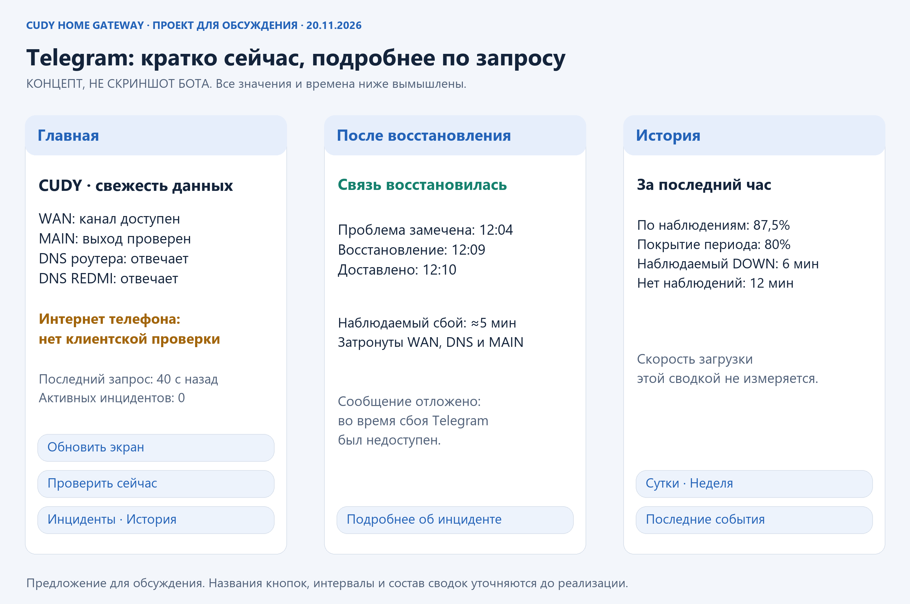

# Telegram Home Gateway

Экран статуса показывает сборку установленного Gateway. Экран результатов VPN читает сохранённый Smart Test. Смена MAIN и автовосстановление через бот пока недоступны.

Для разбора недоставленного уведомления в очереди доступен last_route_results: результат последней завершённой попытки через MAIN и, если применялся резерв, через TORRENT.

## Установленный статус с областью и возрастом проверок

Установленный poller показывает канал WAN и DNS роутера отдельно от внешнего
выхода MAIN/Torrent. У каждого egress показывается возраст checked_at и явно
отмечается cache. Источник должен быть live_probe/cache, state=OK, timestamp
целочисленный и не из будущего, возраст <=300 с, IPv4 валидный; явный DOWN
процесса, агрегатного состояния или WAN имеет приоритет. Служба обозначается
по dedicated xray_process, название узла — configured, не active autoswitch.
Иначе результат обозначается как непроверенный/устаревший,
старый IP не показывается как текущий. Это консервативный UI trust limit,
отдельный от настраиваемого TTL collectors.

Для REDMI отображаются правила, процесс и Kill Switch. Интернет REDMI остаётся
непроверенным: наличие правил и egress MAIN не доказывают клиентский доступ.
Время формирования status snapshot не подменяет возраст внешних probes.
Относительные интервалы явно относятся к обновлению сообщения; для актуальных
данных требуется Refresh. ASCII/NUL и Unicode line/bidi controls в текстовых
полях не пересылаются, oversized значения заменяются фиксированным fallback.
Новые сетевые запросы и действия этот UI-патч не добавляет.
Poller установлен владельцем в составе source
`fb8d9e3b021db592e369290df9753e65cead484d`; Apply и отдельный Verify PASS.
[LIVE-приёмка](reports/HGDEPLOY2_OWNER_SERIES_20261120_LIVE.md).
Для последующих обновлений сохраняются последовательные поколения;
повторный Apply прежнего пакета не является обновлением.

## Следующая итерация — проект, не установленная возможность

[Переработанный план](OBSERVABILITY.md) отделяет обновление экрана от новой
проверки, добавляет диагностику, просмотр инцидентов/истории и настройку уведомлений.
Read-only навигация не получает права изменения policy. Новые изменяющие callbacks
сохраняют проверку владельца, актуальности и защиту от повторов.



Этап `0.4` добавляет Telegram как read-only control plane. Он не меняет маршрутизацию, PassWall2, nftables, DNS или другие части data plane.

## Секреты

Telegram provisioning хранится только на роутере:

```text
/etc/home-gateway/secrets/telegram.token
/etc/home-gateway/secrets/telegram.user_id
/etc/home-gateway/secrets/telegram.chat_id
```

Файлы должны принадлежать `root` и иметь права `0600`. Token и whitelist не хранятся в Git. Token не должен попадать в логи и не передаётся `curl` через argv.

`telegram.user_id` и `telegram.chat_id` должны содержать только числовой Telegram ID без дополнительных символов.

## Транспорт

По умолчанию Telegram Bot API вызывается через существующий MAIN SOCKS:

```text
127.0.0.1:1082
```

Переопределения доступны только для диагностики через переменные окружения:

- `HG_TELEGRAM_TOKEN_FILE`
- `HG_TELEGRAM_PROXY`

## Диагностические команды

```sh
gateway telegram get-me
gateway telegram get-updates
gateway telegram get-updates OFFSET TIMEOUT
gateway telegram send-message CHAT_ID TEXT [REPLY_MARKUP]
gateway telegram edit-message CHAT_ID MESSAGE_ID TEXT [REPLY_MARKUP]
gateway telegram answer-callback CALLBACK_QUERY_ID [TEXT]
```

## Poller

На целевом OpenWrt установлен ucode `2026.01`, где `fs.popen()` принимает строковую команду. Poller shell-quote'ит каждый аргумент перед передачей в `/bin/sh -c`; Telegram payload не исполняется как shell-код.

Poller:

- принимает `message` и `callback_query` через long polling;
- допускает только один `user_id` и `chat_id`;
- фиксирует следующий `update_id` до обработки update;
- отбрасывает сообщения старше 120 секунд;
- `/start` и `/status` всегда открывают главную; `/vtest`, `/actions` и `/help` открывают соответствующие разделы;
- каждый экран содержит постоянную навигацию: Главная, Результаты vtest, Действия, Помощь;
- обновление результатов остаётся на экране vtest; заблокированный запуск не маскируется под кнопку запуска;
- отвечает на callback через `answerCallbackQuery`;
- обновляет dashboard через `editMessageText`, не создавая новое сообщение при refresh;
- хранит callback nonce, timestamp и `message_id` в runtime state;
- постоянные `nav:status`, `nav:vtest`, `nav:actions`, `nav:help` разрешают только фиксированные просмотры после whitelist-проверки;
- они работают в старых сообщениях, после перезапуска poller и без callback state;
- подготовка действий по-прежнему требует актуальных nonce, message ID и TTL 120 секунд; confirm — отдельного одноразового токена;
- старый формат callback сохраняет исходные проверки nonce/message/TTL и не получает обхода защиты;
- использует runtime lock, чтобы loop-mode имел единственного активного poller;
- не изменяет data plane.

Runtime-файлы:

```text
/tmp/home-gateway/telegram.offset
/tmp/home-gateway/telegram.callback
/tmp/home-gateway/telegram-poller.lock
```

Они намеренно находятся в `/tmp`. После reboot старые Telegram updates отсекаются по времени, подготовка действия из старого dashboard не проходит без runtime state. Постоянная навигация может только открыть свежий просмотр; действие она не выполняет.

## procd

Постоянный poller запускается сервисом:

```text
/etc/init.d/home-gateway-telegram
```

Сервис использует procd и respawn. На целевом CUDY проверены штатный restart, crash-respawn, singleton lock и boot autostart.

## Проверенный security/runtime contract

Перед завершением `0.4` на целевом роутере подтверждены:

- whitelist `user_id`/`chat_id`;
- отбрасывание stale message;
- ротация callback nonce после успешного refresh;
- отклонение callback подготовки действия от старого dashboard;
- TTL подготовки/подтверждения действий 120 секунд;
- отсутствие повторной обработки уже подтверждённого update;
- singleton loop с exit `73` для второго poller;
- procd respawn после аварийного завершения;
- отсутствие изменений routing, PassWall2, nftables и DNS.

## Исправление навигации после RC-B 20261020.2

Owner screenshot подтвердил ответ нового Telegram runtime и показал неудобный экран
vtest с одинаковой клавиатурой и без возврата на главную. Код объясняет две причины:
просмотры имели тот же 120-секундный срок, что и привилегированные действия, а
`refresh` терял текущий раздел. Это не доказательство ошибки самого `/start`:
командный обработчик явно открывает главную; добавлена отдельная регрессия.

Постоянные кнопки просмотра не содержат capabilities перезапуска. Набор маршрутов
строго закрыт; неизвестный `nav:*` не вызывает prepare/confirm или внешний runner.
Переход сначала запрашивает отмену ожидающего действия. Для подтверждения есть
явная кнопка «Отмена · Главная». Недоступное/удалённое сообщение заменяется новым
просмотром, только по точному API-ответу о пропавшем/нередактируемом сообщении.
Timeout и неизвестные API-ошибки не запускают повторную отправку; одинаковые
результаты остаются в том же сообщении без ложной ротации nonce/TTL. Callback подтверждается до
сбора статуса, чтобы Telegram не держал индикатор загрузки.

Экран vtest показывает только проверенные наблюдения, без строк с пустыми `?`.
Отсутствие результатов и UNKNOWN не выдаются за завершённый тест. Запуск vtest,
смена MAIN и включение Safe Actions этим патчем не разрешаются. Приватные данные,
маршрутизация, init/procd и migration controls не изменяются.

Новые UI-проверки выполняются реальным native ucode с изолированной границей
Telegram API; engine действий проверяется с disposable service fixtures. Это
не LIVE-приёмка интерфейса на CUDY. Применение патча — отдельно владельцем после CI.

В ветке подготовки 1.0 экран MAIN показывает сохранённый узел и активный узел по данным PassWall2. Проверка выхода остаётся отдельной строкой.

Экран /vtest показывает число подходящих узлов и до трёх строк
последнего рейтинга. В каждой строке код страны, медианная скорость
в Мбит/с и задержка в мс. Результат относится к сохранённому отчёту.
Строки STALL входят в число неуспешных замеров.
