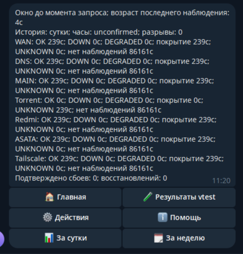

# Установка мониторинга на CUDY — 21.11.2026

## Подтверждено отчётами владельца

На CUDY TR3000 v1 / OpenWrt 25.12.5 установлен source
`1fc822c3bddc1021a1d641c7d7cce71fab7332b8`, runtime 0.5.0-dev,
из [выпуска v0.5.0-dev.20261121](https://github.com/bsekinaev/cudy-home-gateway/releases/tag/v0.5.0-dev.20261121).
Непосредственный baseline — 62b5c4a. Preflight, Apply и отдельный Verify
имеют RESULT=PASS, одинаковые source и operation. Установка завершена commit/seal;
повторно применять пакет не требуется.

- selftest: PASS=62, FAIL=0.
- doctor: OK=11, WARN=0, FAIL=0.
- Пункт 4 повторно выполнил Verify перед включением сообщений.
- Уведомления WAN, DNS, MAIN VPN и REDMI включены, без повторных напоминаний.
- mute_until=0, delivery_not_before=0: действующей паузы и отключения звука нет.

Агент проверил локальные отчёты и вывод установщика; к роутеру не подключался.
Сырые transport logs, session, operation ID и данные подключения не публикуются.
Тег и пакет остаются неизменными; запись LIVE дополняет их приёмку.

## Первые фоновые наблюдения

На реальном скриншоте владельца дневная сводка показывает последнее наблюдение
4 секунды назад. WAN, DNS, MAIN, REDMI, ASATA и Tailscale имеют 239 секунд OK;
подтверждённых сбоев и восстановлений 0, обнаруженных разрывов 0. Это подтверждает
начало накопления фоновой истории и получение сводки в Telegram, не длительный soak.

Оставшиеся 86161 секунда окна суток отмечены как отсутствие наблюдений — это
время до начала записи, а не авария. Torrent имеет 239 секунд UNKNOWN: внешний
выход в фоновом режиме намеренно не проверяется. Метка часов unconfirmed
означает отсутствие отдельного доказательства синхронизации; интервалы считаются
по времени работы роутера. Работающий ntpd сама по себе такого доказательства не даёт.

Скриншот не содержит IP-адресов или секретов. Значения относятся к моменту снимка.

## Проверка владельца — 22.11.2026

На вопрос об ответах `/status` и `/history`, интернете на компьютере и REDMI
и неожиданных ошибках владелец ответил: «Всё работает».
Проверка основных команд и обоих клиентов принята по подтверждению владельца.

## Что пока не подтверждено

Фактическая доставка сообщения о сбое и восстановлении, полнота накопленной
за длительный период истории и завершённый 24–72-часовой soak отдельными
отчётами ещё не подтверждены. Ответ владельца не заменяет измерение этих условий.

Продолжаем естественное наблюдение; намеренно отключать WAN, питание или VPN
не требуется. Следующее направление — подготовка WAN для нового провайдера
или вышестоящего роутера на прежнем физическом порту.
