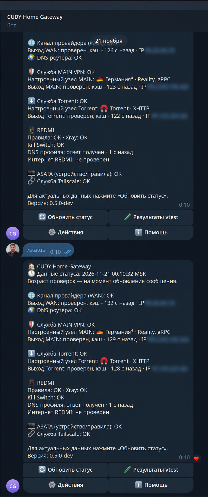

# DNS REDMI: установка на CUDY — 21.11.2026

Владелец предоставил отчёты Preflight, Apply и отдельного Verify из пакета
CUDY-Update-20261120-62b5c4a. Все три стадии завершились RESULT=PASS для source
`62b5c4a9f25bc657fa1456eeacdfdc9039648cae` одной операции.
Журнал проверен, PHASE=COMMITTED; selftest PASS=62 FAIL=0;
doctor OK=11 WARN=0 FAIL=0. Агент к роутеру не подключался.

На скриншоте Telegram отвечает на /status: WAN, DNS роутера, MAIN VPN,
Torrent, правила REDMI, Xray, Kill Switch, ASATA и Tailscale имеют OK.
DNS профиля REDMI: ответ получен, возраст 1 с. Интернет REDMI остаётся
«не проверен»: локальный DNS-ответ не доказывает доступ с телефона.

Скриншот предоставлен владельцем; IP-адреса скрыты перед публикацией.
Приватные сеансы и transport logs остаются у владельца и не входят в Git.
Приёмка не доказывает reboot persistence, длительный soak, клиентский
end-to-end traffic или работу будущего независимого мониторинга.

Следующий этап: проверить расширенный контракт установки до изменений WAN,
инцидентов, доставки и хранения истории. Предыдущий отчёт разработки:
[DNS observer 20.11](REDMI_DNS_OBSERVER_20261120.md).
