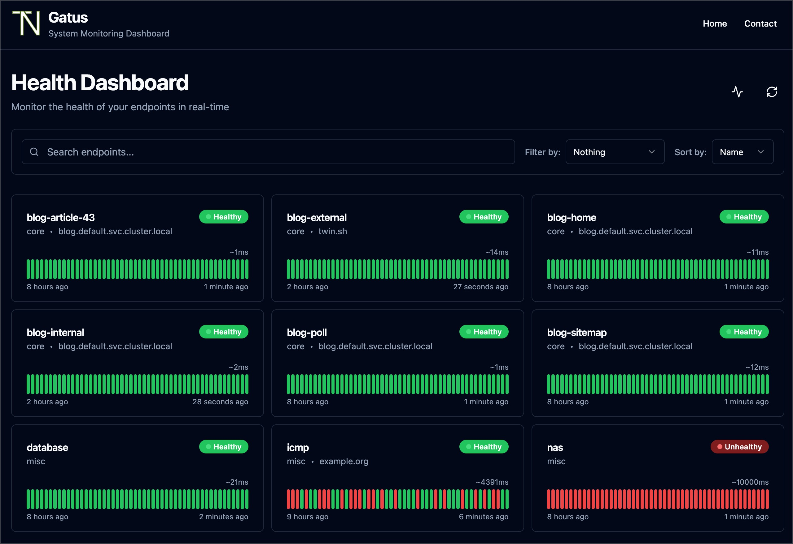
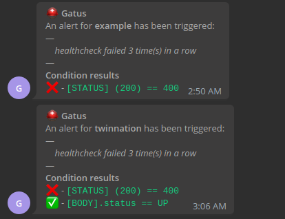

# Что перенять у похожих проектов — 20 ноября 2026

Исследование для следующего этапа CUDY Home Gateway. Изучены официальная
документация и исходники; это не предложение устанавливать все перечисленные
сервисы. Выбор владельца: Telegram, хранение и обработка на роутере,
сообщение о полном обрыве после восстановления, без внешнего watcher и web UI.

Результат: [переработанный проект](../superpowers/specs/2026-11-20-internet-observability-revised-design.md),
[краткий план](../OBSERVABILITY.md). Функции из нового проекта ещё не реализованы.

## Метод и границы

Дата обращения ко всем ссылкам — **20.11.2026**. Для GitHub зафиксированы
снимки исходников: Gatus `655e6f0dc0aca8de5b5018e8e521912fffc2c576`,
Uptime Kuma `160acac6ed696c938a5179113910c6ec352705ed`,
OpenWrt packages `f2aa920111eb5123715af5514921af01fc33e220`,
LuCI `848c6959134cbd457f6ded3c06ff540f1b16592f`.
Ссылки документации могут обновляться после этой даты. Upstream master не
приравнивается к составу установленного OpenWrt 25.12.5. Производительность
чужих проектов на CUDY не измерялась; заявления об их расходе RAM не делаются.

Описания ниже разделяют подтверждённый механизм источника и наше решение.
Чужие инструкции, включая команды перезапуска сети, не исполнялись.

## Сравнение решений

| Проект / первичный источник | Подтверждённый механизм | Применение к CUDY |
|---|---|---|
| [Gatus: alerting](https://github.com/TwiN/gatus/blob/655e6f0dc0aca8de5b5018e8e521912fffc2c576/README.md#alerting) | Отдельные последовательные пороги отказа и успеха; настройка сообщения о разрешении инцидента. | Сохраняем 3/2, добавляем идентичность и свежесть измерения. Это адаптация нашего счётчика, а не готовая функция Gatus против повторного кэша. |
| [Gatus: recommended interval](https://github.com/TwiN/gatus/blob/655e6f0dc0aca8de5b5018e8e521912fffc2c576/README.md#recommended-interval) | Длительность запроса добавляется к интервалу; ограничение параллелизма тоже может задерживать проверки. | Измеряем реальную периодичность и задержку, а не обещаем `30 секунд × 3`. Общий срок цикла и ожидание доставки учитываются отдельно. |
| [Prometheus: alerting rules](https://prometheus.io/docs/prometheus/latest/configuration/alerting_rules/) | `for` удерживает тревогу в pending; `keep_firing_for` позволяет задержать снятие тревоги. | Разделяем наблюдение, инцидент и доставку. UNKNOWN не становится восстановлением. Временной порог поверх счётчика автоматически не добавляем. |
| [Alertmanager: concepts](https://prometheus.io/docs/alerting/latest/alertmanager/) | Группировка, подавление зависимых уведомлений и временные silences. | Объединяем последствия WAN-сбоя в понятное сообщение, сохраняя исходные события и статистику; mute относится к доставке. |
| [Alertmanager: configuration](https://prometheus.io/docs/alerting/latest/configuration/) | `group_wait` ждёт связанные тревоги. Разрешившаяся до окончания ожидания тревога может не породить уведомление. | Не переносим это поведение буквально: подтверждённый локальный инцидент должен попасть в отчёт после восстановления, даже если Telegram всё время был недоступен. |
| [OpenWrt mwan3track](https://github.com/openwrt/packages/blob/f2aa920111eb5123715af5514921af01fc33e220/net/mwan3/files/usr/sbin/mwan3track) | `reliability` задаёт кворум успешных целей; после его достижения оставшиеся могут быть пропущены. Переходы используют score, а не просто наш счётчик последовательных ошибок. | Различаем кворум целей в одном измерении и устойчивость во времени. Два домена — подтверждение DNS-запросов, не два голоса за наличие интернета на телефоне. Маршрутизацию mwan3 не переносим. |
| [OpenWrt watchcat](https://github.com/openwrt/packages/blob/f2aa920111eb5123715af5514921af01fc33e220/utils/watchcat/files/watchcat.sh) | Использует uptime; режимы включают reboot, restart interface и запуск script. Имя функции monitor не означает пассивность. | Берём монотонное время для интервалов. Автоматические перезапуски и изменение сети в этот этап не входят. |
| [LuCI statistics](https://github.com/openwrt/luci/blob/848c6959134cbd457f6ded3c06ff540f1b16592f/applications/luci-app-statistics/root/etc/config/luci_statistics), [collectd rrdtool](https://collectd.org/documentation/manpages/collectd.conf.html#plugin_rrdtool) | В конфигурации LuCI RRD находится в `/tmp/rrd`; collectd умеет объединять записи кэшем. RAM не переживает отключение питания, а буферизация задерживает сохранение. | Ограниченные RAM-данные, периодические checkpoint и разные разрешения истории. Риск потери несохранённого хвоста описываем явно; нулевой износ flash не обещаем. |
| [RRDtool: rrdcreate](https://oss.oetiker.ch/rrdtool/doc/rrdcreate.en.html) | Фиксированный размер архива; отсутствующие/просроченные значения могут быть UNKNOWN; консолидация имеет правила допустимых пропусков. | Заимствуем ограниченность и явные пробелы, но сами определяем знаменатель доступности и покрытие. Усреднённая корзина не доказывает непрерывную исправность. |
| [Uptime Kuma: calculator](https://github.com/louislam/uptime-kuma/blob/160acac6ed696c938a5179113910c6ec352705ed/server/uptime-calculator.js) | Есть минутные/часовые/дневные агрегаты. В этом снимке `flatStatus` переводит PENDING в DOWN, MAINTENANCE в UP; пустой диапазон имеет fallback на последнее значение. | Берём идею нескольких разрешений, не копируем трактовку состояний: у CUDY пропуск остаётся UNKNOWN, обслуживание учитывается отдельно, прошлый успех не заполняет пустой период. Это различие моделей, не утверждение об ошибке Kuma. |
| [Healthchecks: documentation](https://healthchecks.io/docs/) | Период heartbeat и grace определяют запоздание; есть состояния New, Up, Late, Down, Paused. Обычно проверяет источник снаружи. | Переносим идею просроченного heartbeat на свежесть локального сборщика. Внешний сервис исключён решением владельца; выключенный роутер не может сам сообщить о выключении. |
| [vnStat: руководство автора](https://humdi.net/vnstat/man/vnstat.html) | Статистика интерфейсных счётчиков и объёма трафика по периодам. | RX/TX полезны для контекста, но наличие или отсутствие трафика не заменяет проверку доступности. Отдельный vnStat ради этой задачи не требуется. |
| [Telegram Bot API](https://core.telegram.org/bots/api#responseparameters), [sendMessage](https://core.telegram.org/bots/api#sendmessage) | `retry_after` задаёт ожидание при flood control; текст sendMessage ограничен 4096 символами после обработки entities. | Ограниченный отправитель, разбиение длинной сводки и уважение server backoff. Документированного idempotency key у sendMessage нет: возможный дубль при потерянном ответе остаётся ограничением нашей at-least-once очереди. |

## Что меняется в нашем плане

1. Перед DNS и новыми экранами появляется общий контракт свежего измерения.
   Независимость определяется временем и идентификатором проверки, а не числом читателей кэша.
2. Сбор и накопление минимальной истории начинаются раньше включения доставки.
   Текущий mute уже не останавливает tick при enabled=true; выключенный enabled
   останавливает оба, и именно эту зависимость надо устранить.
3. Исходные симптомы сохраняются отдельно от вывода о причине. WAN down не
   считается доказанной причиной каждой параллельной ошибки; подавление требует
   свежих связанных данных и не скрывает проблему Kill Switch.
4. Учитываем `first_seen`, подтверждение, восстановление, доставку и пробелы
   отдельно. Длительность жизни инцидента не равна доказанному времени DOWN.
5. История независима от очереди сообщений. Очищенный receipt не должен удалять
   единственное основание недельной статистики.
6. Для фонового цикла нужен стендовый замер: Telegram timeout/429/backlog не
   должен вытеснять наблюдение. Отдельная служба остаётся запасным вариантом.
7. Полноценные чужие серверы не выбираем по предполагаемой тяжести: они не нужны
   при принятом интерфейсе и уже имеющемся стеке. Их поведение используем как образцы.

## Реальные изображения похожего проекта

Ниже **официальные скриншоты Gatus**, а не установленного CUDY. Они показывают
отдельные цели, историю проверок и объяснение причины в Telegram. Наличие web
dashboard в примере не меняет решение владельца оставить только Telegram.

Изображения взяты без изменений из `.github/assets` зафиксированного Gatus commit.
Проект распространяется под Apache-2.0; сохранены [лицензия](../assets/observability/2026-11-20/GATUS-LICENSE.txt)
и [атрибуция с URL и SHA256](../assets/observability/2026-11-20/CREDITS.md).
Корневого NOTICE в просмотренном снимке не найдено.
Внешний [пример Telegram от автора Uptime Kuma](https://louislam.net/uptimekuma/3.jpg)
оставлен ссылкой: отдельные условия переноса файла с этого сайта не установлены.

## Что исследование не установило

Не измерены расход ресурсов и гарантированная задержка на CUDY. Не доказаны
доступность с REDMI, фактическая policy уведомлений и восстановление после
выключения питания. Интервалы 60 секунд и сроки хранения 7/30 суток в проекте —
наши стартовые предложения, а не upstream defaults и не уже включённые настройки.
