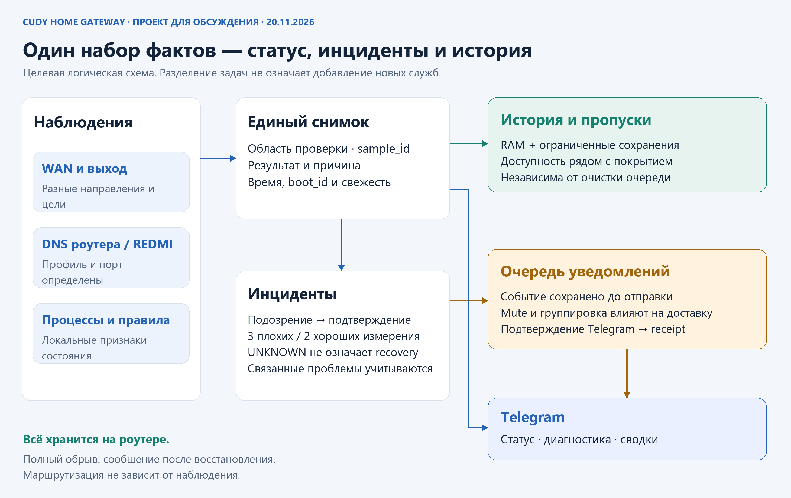
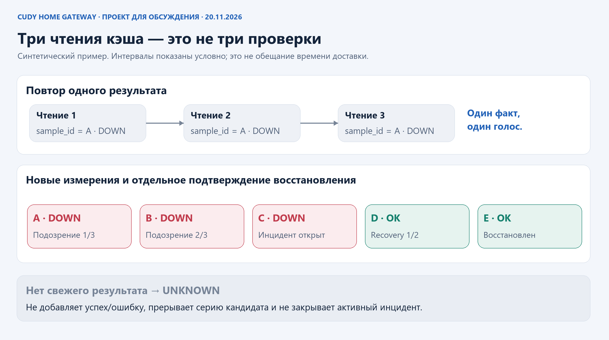
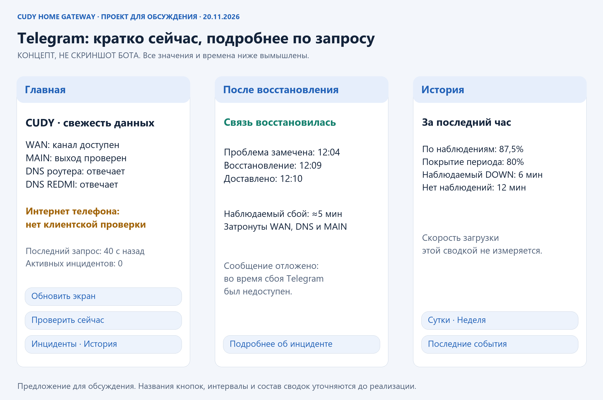
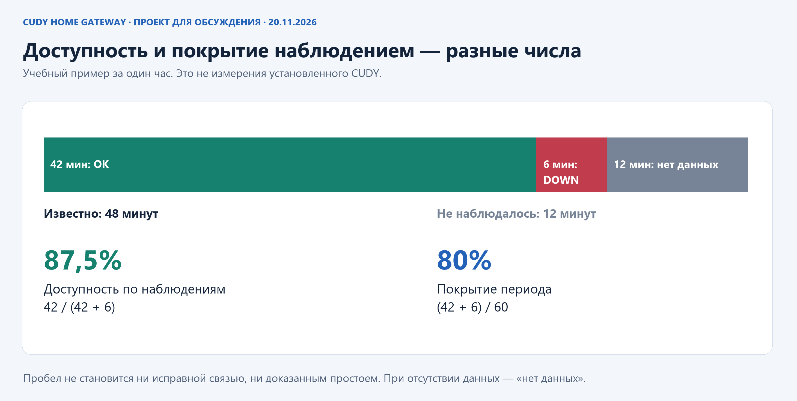

# Наблюдение за интернетом: переработанный проект

Дата: 20.11.2026. **Статус: проект для обсуждения после исследования; продуктовый
код и настройки роутера этим документом не изменены.**

Основание: [первоначальный замысел](2026-11-18-internet-observability-design.md),
[исследование похожих проектов](../../research/2026-11-20-monitoring-projects.md),
[принятая установка](../../reports/HGDEPLOY2_OWNER_SERIES_20261120_LIVE.md).
Краткая пользовательская версия: [OBSERVABILITY](../../OBSERVABILITY.md).

## Цель и решения владельца

Владелец должен понимать, что проверено, где возникла проблема, когда данные
получены и что происходило за выбранный период. Telegram — основной интерфейс.
Сбор, состояние и история остаются на роутере. Полный обрыв сообщается после
восстановления; внешний наблюдатель и web UI не добавляются. Уведомления не
переключают MAIN и не перезапускают сеть. Кабель уже имеется как аварийный резерв.

Владелец согласовал целевой ориентир **2–4 минуты до уведомления об устойчивой
проблеме при доступном Telegram**. Это цель будущей реализации, ещё не подтверждённая
замером всей цепочки. Полный обрыв по-прежнему сообщается после восстановления.
Приведённые ниже интервалы и лимиты остаются предложениями для стендовой проверки.

## Уточнения владельца и WAN

Автоматические сообщения только WAN/DNS/MAIN VPN/REDMI, круглосуточно,
один сбой и одно восстановление, без напоминаний. Сводки только по запросу.
Приняты целевые 7 суток подробностей / 30 суток дневных агрегатов и допустимая
потеря до 15 минут несохранённых подробностей при отключении питания.
Размерные ограничения остаются предметом измерения.

REDMI проверяется независимо от присутствия телефона. Смена локации остаётся
в PassWall2; бот диагностирует профиль и не обещает клиентскую end-to-end пробу.

При переезде прежний WAN-порт подключается к новому провайдеру или роутеру.
Отдельная подготовка: приватный backup конфигурации OpenWrt (не runtime kit),
проверка конфликта подсетей и карточка подключения. Сетевой адаптер должен
различать адрес/маршрут/DNS/direct, инвалидировать кэш и серии при смене сети;
история отделяет старое подключение от нового. Текущий direct curl уже привязан
к фактическому WAN-устройству; проблема планирования — не отсутствие привязки,
а совместимость маршрутов/протоколов и кэш без отпечатка сети. DHCP/static/PPPoE,
маршрут без обычного via и IPv6 — стендовые сценарии, не доказанные live-баги.
Изменения network.sh требуют расширенного пути поставки. Автоматическое изменение
WAN и переключение REDMI из Telegram не добавляются. Полный порядок и приёмка:
[программа выпусков](../../OBSERVABILITY_PLAN.md).

## Что уже есть и что остаётся сделать

| Возможность | В установленном source fb8d9e3 | Следующая работа |
|---|---|---|
| Telegram | Область/возраст внешних проверок; REDMI без ложного подтверждения интернета | Компактные разделы, диагностика, настройки уведомлений |
| Health | Отдельные компоненты и external evidence | Свежесть и идентичность измерения используются всеми потребителями |
| Инциденты | 3 наблюдения для OPEN/CHANGE, 2 для recovery; UNKNOWN/MAINTENANCE не закрывают инцидент | Учитывать только новые измерения, фиксировать пробелы и границы времени |
| Доставка | Очередь, retry, receipt, mute, категории, recovery coalescing, compaction | Реальная приёмка доставки, группировка причин, режим возобновления |
| Фоновый сбор | Tick запускается worker только при notification policy enabled=true | Наблюдение независимо от включения отправки |
| История | Журнал инцидентов ограничен compaction очереди | Отдельные ограниченные статистические агрегаты |
| DNS REDMI | Процесс/правила и профиль, без отдельной DNS-пробы | Обнаружение актуального endpoint и ограниченная проверка |

Наличие двух работающих procd instances не подтверждает включённую policy и
успешную доставку Telegram. Mute уже сохраняет tick при enabled=true; его не надо
«реализовывать заново». При enabled=false сейчас прекращается и сбор.

## Подходы и выбор

**A — развивать существующие два процесса.** Poller отображает состояние;
notifications worker получает ограниченный планировщик наблюдения/очереди.
Логические обязанности разделены, структура запуска сохраняется. Это выбранный
рабочий вариант предыдущего предложения, одобренного владельцем как план.

**B — отдельный collector process.** Лучше изоляция от зависшего отправителя,
но меняет init/procd contract: нынешняя приёмка ожидает ровно poller и notifications.
Потребует отдельного согласованного обновления admission/сервисной проверки.

**C — готовый внешний стек.** Gatus/Kuma/Prometheus полезны как источники решений,
но их серверы и web UI не нужны для выбранной задачи. Не утверждаем, что они
не запустятся на 512 MiB: сравнительных замеров не было.

A остаётся рекомендацией **при условии стендовой проверки сроков цикла**.
Планировщик не запускает сетевую отправку, если её полный бюджет вытеснит
следующее наблюдение. Если это ограничение не удаётся обеспечить, переход к B
оформляется отдельным решением до выпуска, а не скрытым добавлением третьей службы.

## Общий контракт наблюдения

Результат содержит `scope`, `target`, `sample_id`, `boot_id`, incarnation сборщика,
время начала/окончания в uptime, wall-clock с признаком доверия, результат,
фиксированный reason, источник, срок свежести и отпечаток обнаруженного runtime.
Идентичность включает boot/incarnation/sequence; перезапуск процесса не повторяет ID.
Секреты, пользовательские URL и полные generated configs в результат не попадают.

Scope задаёт точное утверждение: линк WAN, контрольный DNS-запрос к локальному
resolver, запрос через MAIN/Torrent, процесс, правило. Результат с роутера
не объявляется проверкой Wi-Fi, приложений или сквозного доступа телефона.

Новый завершённый результат учитывается один раз. Чтение кэша сохраняет исходный
ID и время, а не создаёт новый голос для 3/2. При смене runtime отпечатка старый
результат становится неподходящим. Просроченное/повреждённое/отсутствующее измерение
даёт UNKNOWN. Перегруженный сборщик отмечает пропуск, а не создаёт фиктивные
проверки за пропущенные интервалы. Вывод о причине отделён от исходных фактов.

## Этап 0: исходное состояние и наблюдение 24–72 часа

Зафиксировать установленный source, policy доставки без секретов, счётчики
перезапусков двух процессов, очередь, свободную память/flash и фактическое время
выполнения status/health. Состояние source fb8d9e3 уже принято владельцем;
не выдавать эту приёмку за измерение следующих суток.

Пока независимый сбор не выпущен, наблюдение — эксплуатационная проверка бота
и клиентов, а не готовая автоматическая статистика доступности. После появления
сборщика провести отдельные 24–72 часа с учётом покрытия и ресурсных максимумов.
Сохранить краткий отчёт; конфиги с token/ключами и transport logs остаются приватными.

Готовность: нет необъяснимых повторных запусков, неограниченного роста очереди
или потребления ресурсов; причины пропусков видны. Ради проверки не обрывать
пользовательский интернет, не перезагружать CUDY и не выключать защиту REDMI.

## Этап 1: DNS и надёжные ограниченные измерения

1. Связать настроенный REDMI-профиль с актуальным процессом/config/listener.
   Значения `acl_A2dNs`, 2004 и 2007 не становятся универсальными константами.
   Отсутствующее или неоднозначное соответствие — UNKNOWN без запроса к
   произвольно найденному сервису. Проверить отпечаток до и после запроса.
2. Отдельно проверять DNS роутера и resolver REDMI-профиля. Исправить исходную
   модель: dns.sh читает настроенный port, но его текущая nslookup-проба этот port
   явно не передаёт. Синтаксис работы с нестандартным портом проверить на
   конкретной установленной сборке BusyBox, не предполагать поддержку `#port`.
3. До кода выполнить маленький локальный стенд с UDP/TCP DNS fixture: правильный
   endpoint, transaction ID, rcode, тип ответа, truncated/ошибочный пакет, timeout.
   Положительный кэшированный ответ resolver подтверждает именно запрос, не
   независимую свежесть upstream и не весь интернет.
4. Основная контрольная зона и запасная только при неуспехе. Их выбор и критерии
   A/AAAA/NXDOMAIN зафиксировать в плане этого выпуска после проверки инструмента.
   IPv4/IPv6 не объединять в один успех без явно выбранного scope.
5. Бюджет одного запроса ориентировочно 2–3 с, одной законченной сетевой задачи
   до 15 с. Это не обещание проверить все scopes за 15 с: полная загрузка
   расписания, допустимое число задач и время отправки считаются на стенде.
   Окончательные числа принимаются по этому замеру. Нет неограниченных повторов,
   concurrent дублей и проверки REDMI через подменённый MAIN endpoint.

Предлагаемые начальные интервалы: дешёвые локальные признаки 30 с, активные
проверки 60 с. Positive/negative cache согласовать с этими интервалами: нынешний
положительный egress TTL 300 с нельзя одновременно назвать минутной независимой
проверкой. Отрицательный кэш и backoff ограничивают нагрузку при аварии, но не
создают новые голоса. Истёкшая свежесть остаётся видимой.

В фазе pending backoff не должен делать серию подтверждения невозможной:
очередные независимые пробы должны укладываться в выбранное окно свежести.
Повтор допустимого кэша игнорируется счётчиком; истёкшая свежесть прерывает серию.
Если все выбранные scopes не помещаются в 60-секундное расписание, интервалы
пересматриваются явно до выпуска, а не скрыто растягиваются под нагрузкой.

Готовность: тесты смены/пропажи профиля и порта, отсутствующей утилиты,
некорректного ответа, одинакового ID, истёкшего результата и изменения runtime
во время проверки; UI и health показывают одну область/дату. Сети/правила не меняются.

## Этап 2: наблюдение независимо от доставки и инциденты

Collector работает независимо от enabled/mute/categories отправителя. Выключить
само наблюдение — отдельная явная операция с отображаемым пробелом. Чтение
экрана использует снимок; оно не создаёт новый независимый сбор.

Планировщик использует монотонные due-times, не `sleep + произвольная работа`.
Один deadline охватывает всю проверку, включая discovery, secondary и разбор
ответа. Отправка имеет полный бюджет MAIN+fallback; число сообщений за слот
ограничено. Медленный Telegram, 429 и backlog не вытесняют наблюдение. Просрочка
фиксируется как пропуск, heartbeat сборщика доступен poller.

Сохраняем раздельные автоматы: результат измерения; pending/open/recovering/closed
инцидент; pending/inflight/sent/failed/coalesced доставка. DOWN/DEGRADED пороги
3 и recovery 2 применяются к новым допустимым измерениям данного scope.
UNKNOWN/MAINTENANCE прерывают серию кандидата, не означают успех и не закрывают OPEN.

Длительности внутри одного boot считаются по uptime. Wall-clock используется для
отображения и связи с датой; до NTP — «время не подтверждено». Перезапуск, потеря
RAM и скачок часов создают границы наблюдения. У elapsed lifecycle, времени
наблюдаемого DOWN, UNKNOWN и доставки разные значения. Старое `duration_seconds`
нельзя незаметно переопределить в сохранённых событиях.

При номинальном активном интервале I=60 с и трёх ошибках путь до подтверждения
содержит фазу до I, ещё 2I и время выполнения. Поэтому рабочий ориентир уведомления
**2–4 минуты только при доступном Telegram**, уже согласованный владельцем;
пригодность расписания требует замера всей цепочки. Пауза 300-секундного кэша
и длинный retry не скрываются из оценки.

Готовность: длительный отказ Telegram не прекращает новые измерения; повтор
кэша не открывает инцидент; разрывы не дают ложное recovery; после рестарта
из журнала восстанавливаются открытые инциденты. Ресурсный прототип определяет,
остаётся ли подход A пригодным. CPU/RAM измеряются, а не оцениваются на глаз.

## Этап 3: понятные сообщения и доставка после аварии

Группировать связанные симптомы, сохраняя все факты. WAN down позволяет
сгруппировать последствия только при свежих согласованных наблюдениях.
Один неотвечающий HTTP-провайдер не доказывает WAN down. Проблема Kill Switch
не подавляется как вторичная. Вывод о причине имеет степень уверенности.

Для подтверждённого инцидента журнал записывается до отправки. Если связи с
Telegram во время сбоя не было, после recovery остаётся отчёт: scope, начало
наблюдаемой проблемы, подтверждение, восстановление, известные пропуски,
отложенная доставка и стабильный ID. Групповое ожидание не удаляет этот факт.
Доступность Telegram проверяется отдельно от доступности внешнего тестового сайта.

Полный OFF отправки: наблюдение и статистика продолжаются; после включения
показываются текущее состояние и ограниченный catch-up, а не шквал старых OPEN.
Mute предлагается на 1/3/8 ч с видимым сроком и снятием вручную. Временная пауза
не меняет длительность измеряемого состояния. Неотправленные записи связываются
со сводкой только crash-safe преобразованием; не маркируются SENT без ACK.

Сохраняются MAIN/Torrent transport policy, `retry_after`, ограниченный backoff
и at-least-once. Смена сетевой policy ради доставки не требуется. Потерянный ACK
может дать дубль с тем же ID; exactly-once не обещается. Новые сообщения после
восстановления могут ускорять только сетевой backoff, но не обходят Telegram 429.

Готовность: mute/off/on, короткие и длительные сбои, несколько зависимостей,
потеря ответа после отправки, 429, ошибка токена, переполнение, crash при compaction
и backlog после восстановления. На CUDY — согласованное безопасное тестовое
сообщение; сетевые аварии и SIGKILL воспроизводятся в изолированной VM.

## Этап 4: Telegram и диагностика по запросу

Главная кратко показывает scope, состояние, возраст и активные проблемы. Детали
открываются отдельно. «Обновить экран» читает снимок; «Проверить сейчас» создаёт
ограниченную задачу с объединением дублей, сроком ожидания и cooldown. Запрос
с Telegram не исполняет произвольные адреса, команды или изменения конфигурации.

Диагностика идёт от локальных признаков к DNS и разрешённому внешнему тесту.
Она показывает подтверждённые факты, вероятную причину и следующий безопасный
шаг; недостаточные данные не превращаются в автоматическое «починено».
Проверки DNS не переименовываются в клиентскую проверку REDMI.

Новые read-only кнопки сохраняют whitelist user/chat и совместимость старой
навигации. Изменение mute/categories требует владельца, свежего callback/защиты
от повторного изменения и проверки состояния; старым read-only `nav:*` не выдаётся
право изменять policy. Existing actions/confirm сохраняют свои TTL и одноразовость.

Готовность: старые сообщения, повторные нажатия, рестарт poller, неавторизованный
callback, длительная диагностика и недоступный компонент. Callback получает быстрый
ответ, сообщение обновляется по результату; десятки нажатий не создают десятки probes.

## Этап 5: история качества и её раннее накопление

Минимальные интервалы, пробелы и переходы надо начать сохранять на этапе 2;
отображение сводок выпускается позже. История не зависит от удаления receipts
и последних 128 закрытых инцидентов в notification compaction.

Для бинарного контрольного scope считаем `up_seconds`, `down_seconds`,
`unknown_seconds`, отдельно planned maintenance. Интервалы — **оценка по
измерениям**: последнее значение действует только в пределах своего TTL;
остаток до следующего результата — UNKNOWN. Нельзя доказывать непрерывную
доступность между пробами. Pending инцидента сам по себе не превращается в DOWN:
для истории нужен результат измерения, а не промежуточный статус автомата.

Доступность по наблюдаемому времени `up/(up+down)`, покрытие полного окна
`(up+down)/window`. При нулевом знаменателе — «нет данных». Maintenance показывается
отдельно, не как UP. Для составного DEGRADED-компонента нет автоматического
перевода в бинарный успех: выводить состояние и отдельные контрольные scopes.
Статистика внешнего теста не называется доступностью всех сайтов или телефона.
Наблюдаемый DOWN может быть короче порога открытия инцидента — это объясняется в UI.

Принятая цель хранения: ограниченные RAM samples, 7 суток интервалов/событий,
30 суток дневных агрегатов. Размерные caps принимаются по прототипу; начальный
проектный потолок новой истории — 8 MiB суммарно, при сохранении прежних ограничений
очереди. Это cap, не резервирование flash и не разрешение увеличивать её файлы.
Checkpoint агрегатов с допустимой потерей не более 15 минут несохранённых подробностей; подтверждённые события —
при переходе. Последние несохранённые агрегаты могут потеряться при power loss.
После boot этот хвост считается неизвестным, не восстанавливается выдуманными значениями.

Предел размера важнее календарной глубины при аномальном числе событий:
сохраняются активные инциденты и основания неотправленных сообщений, а полнота
статистики уменьшается с явным флагом. Новая история не удаляет очередь ради
места. При низком свободном месте подробная запись приостанавливается; data plane
не затрагивается. Политика retention учитывает atomic copy/redo и запас места,
а не только размер финальных файлов. История не содержит просмотренных сайтов.

Готовность: корректные формулы, неполный день, boot/gap, несинхронные часы,
повреждение checkpoint, ограничение размера и concurrent compaction; один
WAN-сбой не суммируется трижды вместе с DNS и MAIN. Скорость передачи данных
и «пинг сервера» из длительности DNS/HTTPS-проверки не выводятся.

## Поставка и совместимость

Текущий V2 допускает только пять observer/UI файлов и фиксированные 20 runtime
paths. Изменения incidents/notifications, CLI, init и добавление нового модуля
не следует маскировать под такой пакет. До этапа 2 нужен отдельно проверенный
путь расширенной поставки: полный inventory, scope изменений, сохранение старых
receipts, восстановление и явная работа с изменением количества файлов.

Rollback кода не откатывает очередь или пользовательские данные во времени.
Новая запись должна оставаться читаемой предыдущим runtime; это доказывается
fixture старого читателя. Если не получается — сначала совместимый bridge release,
затем новая запись. Новые scopes не добавляются неявно в старый список семи
notification categories. Формат и поведение расширения — отдельный будущий дизайн,
а не обещание, что V2 уже поддерживает такие изменения.

Перед каждым выпуском: компонентные и fault tests по затронутому поведению,
независимый review, требуемая exact-source CI/native приёмка, owner Preflight →
Apply → отдельный Verify и проверка клиентов. Нынешние gates не ослабляются
ради сокращения времени тестов. Эта документация их не заменяет.

## Очередность и решения перед реализацией

1. Эксплуатационный baseline и прототип DNS-инструмента/полного бюджета цикла.
2. Наблюдательный выпуск DNS/freshness в пределах действующего updater.
3. Проверенный расширенный путь обновления и совместимость persistent state.
4. Независимый сбор, минимальное накопление истории и инциденты по свежим samples.
5. Приёмка доставки/группировки/mute/catch-up; затем Telegram диагностика и сводки.
6. Soak 24–72 часа каждого принятого этапа с покрытием и ресурсными измерениями.

Цель задержки, категории, режим сообщений, сроки истории и допустимый RAM-хвост
согласованы. После уточнения переезда добавлена отдельная ветка WAN; актуальный
порядок вместо предварительного списка выше — в [программе выпусков](../../OBSERVABILITY_PLAN.md).
[Подтверждённые вводные](../../research/2026-11-20-observability-planning-inputs.md).
DNS-клиент, полное расписание, размеры и write budget — измеряемые решения
разработчика. Исследование не заменяет стендовых измерений.
